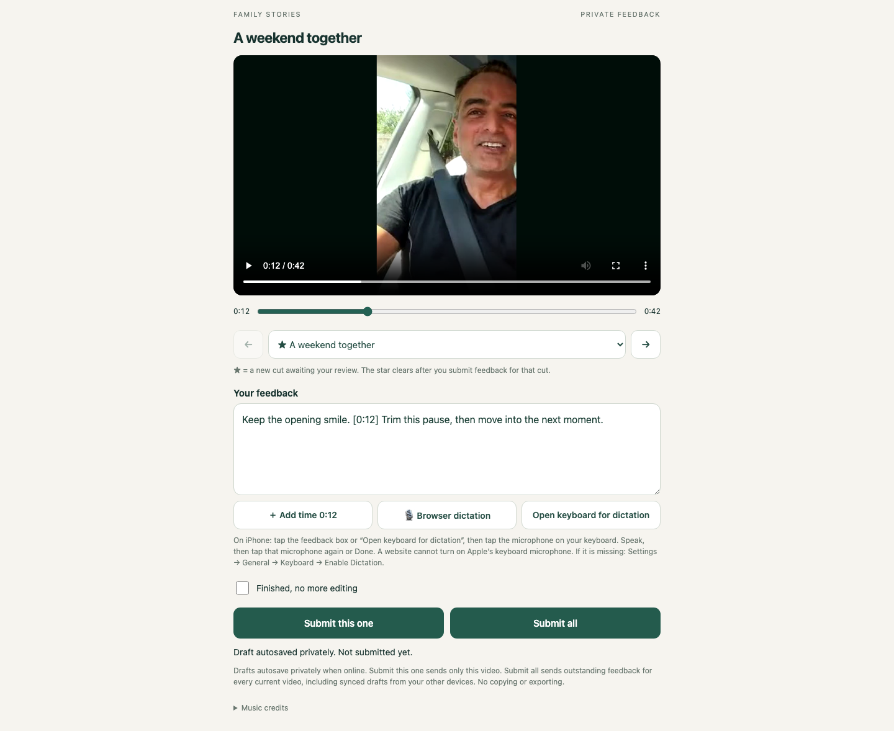
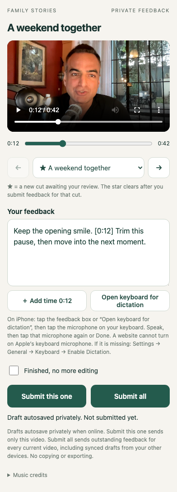

# Family Video Feedback

### A quiet review room for family videos and the agents that edit them.

Watch a cut, say what should change, and move to the next video. Feedback stays next to the right revision, with no JSON copying or exports required.

## A familiar view, on either screen

### Desktop


### Mobile


The screenshots use an adult-only example still and fictional review text. No family videos, children's images, real feedback, or account configuration are included.

## What it does

- Video on top, one feedback box below.
- Previous/next arrows and a video dropdown.
- Scrubbing and an **Add time** button for comments about a moment.
- Visible dictated text; on iPhone, use the keyboard microphone.
- Local backup and private server autosave for unsubmitted drafts.
- **Submit this one** or **Submit all**, with explicit success and partial-failure messages.
- A star for a newly edited cut awaiting feedback.
- **Finished, no more editing** to protect approved cuts.

## Get started

You need **Node.js 22+** and your own MP4 previews. No dependencies to install.

```sh
cd assets/app
npm test
npm start
```

Open **http://127.0.0.1:8765**. From that same `assets/app` directory, add your videos to `media/` (created on first start), then edit `public/stories.json`. The sample catalog contains fictional titles, not bundled footage.

For example:

```json
{
  "key": "weekend",
  "id": "weekend-v1",
  "title": "A weekend together",
  "filename": "weekend-v1.mp4",
  "duration": 42,
  "credits": ""
}
```

When your agent makes a new cut, change its `id` and `filename`. Keep its `key` so the link still works.

## Use it as an agent skill

Give your agent this folder and ask it to read **[SKILL.md](SKILL.md)**. If your agent supports local skills, copy the folder into that agent's documented skills directory. No particular agent account or hosting platform is required.

Try:

> Set up a private review page for these videos using this skill. Keep my originals unchanged. Once I submit feedback, read it and show me what you will edit. Leave videos marked Finished alone.

The agent reads structured feedback from the local/private API. Submission saves records; it **does not automatically notify or wake an agent**. Agree on how the agent will check for new submissions. Drafts are distinct from submitted feedback.

## Privacy first

This repository is code and documentation, **not a place to store your family archive**. Videos and feedback are gitignored and stored separately. The server defaults to loopback-only access. For phone or remote use, an authenticated HTTPS reverse proxy is required; the starter does not set one up. A secret link alone is not sufficient.

Read **[setup, security, data model and limitations](references/workflow.md)** before deploying. In particular, protect media and API routes, back up private storage, and don't put tokens in browser code.

## What this is not

It is not a video editor, cloud account, public sharing service, automatic transcription service, or multi-user collaboration platform. It provides a review interface and a repeatable agent workflow. Editing style belongs to the person making the videos, not to the tool.

## Testing

Run `npm test` inside `assets/app`. Tests cover draft isolation and idempotency, range serving, submission selection and partial failures, and dictation lifecycle. Physical iPhone behavior must be checked on a real device; desktop tests cannot guarantee microphone support.

## License

The code and documentation text are released under the **[MIT License](LICENSE)**. The license excludes the screenshots (`docs/desktop.png` and `docs/mobile.png`) and the image and likeness of Andrew Warner shown in them; no rights to those images or that likeness are granted.
